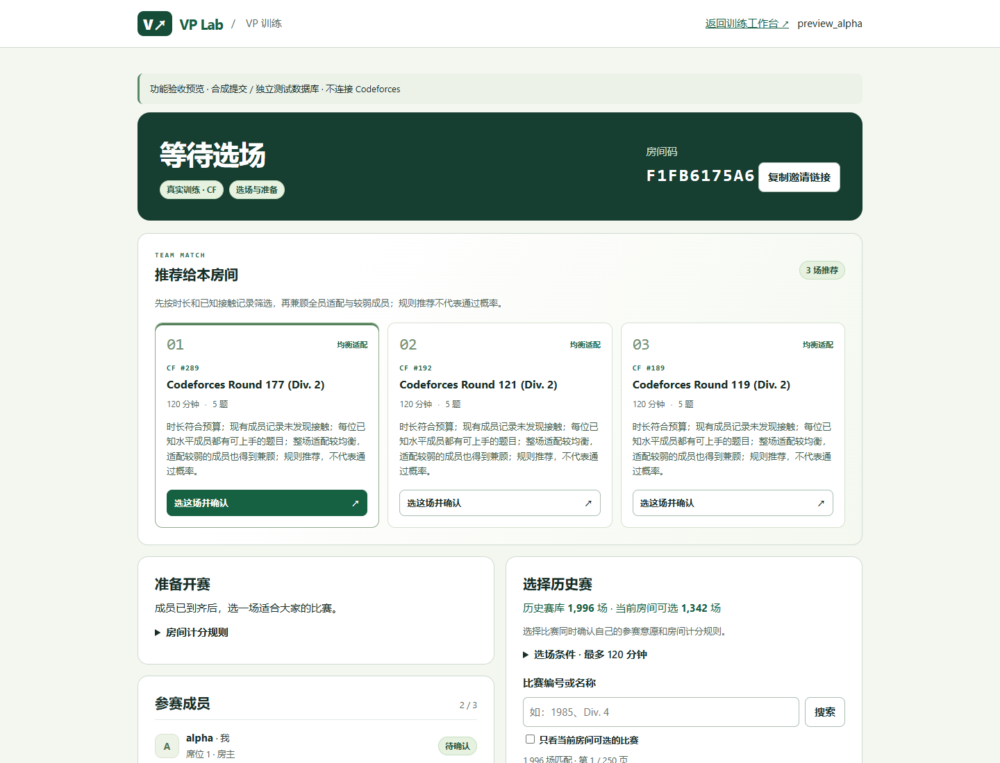
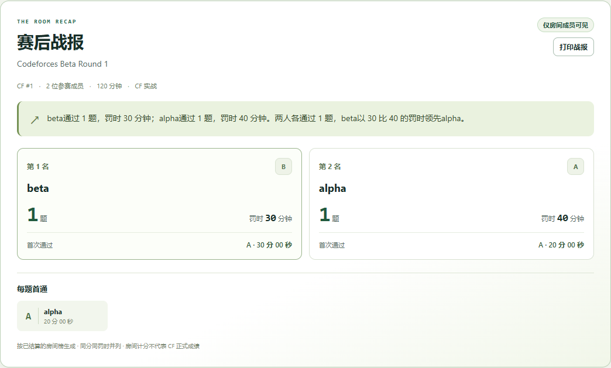
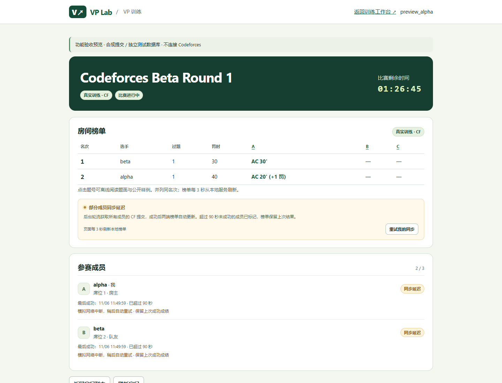

# VP 房间：战报、小组推荐与自动同步

本次实现对应 FR-20、FR-06～08、FR-13 / NFR-03。沿用原有本地账号、房间成员、赛库和计分规则，不增加外部服务或运行依赖。

## A · 房内赛后战报

房间结算后显示固定模板战报，并支持只打印该区。每人展示过题数、计分罚时、个人首次通过的题号和时间；另列每题房内首通，同秒并列全部保留。并列仍按原榜单使用 1、1、3 的名次。

战报只读取持久化的 `final_board`，不重新请求 CF 或重新解释分数。GET `/api/rooms/{id}/report` 与房间视图均检查当前登录账号是否为成员；非成员返回 404，未登录返回 401，未结算返回 409。回放有明确标记。

验收例：甲第 5 分钟 WA，第 20 分钟 AC，计分罚时为 20 + 20 = 40；乙第 30 分钟直接 AC，计分罚时为 30。两人各过 1 题，乙领先，但该题房内首通是甲。测试同时检查这两个不同事实。

## B · 最多三场小组推荐

“推荐给本房间”独立于赛库搜索，所有成员可查看，房主可选场并确认。每次读取等待中的房间，按当前成员、设置及已导入记录重算；搜索不会缩小推荐池。

1. 先排除超过房间预算的场次，以及不允许重复练习时成员已知接触过的场次。只返回合格场次，不为凑满三场放宽条件。
2. 每位成员优先使用个人设置的参考 Rating；否则仅使用 handle 匹配的已同步 CF Rating。缺少水平时不虚构默认评级，也不声称未知成员已经适配。
3. 对每个已知水平 R，以整场各题与 R+100 的接近度计算适配：`max(0, 1000 - abs(problemRating - (R+100))) / 1000`，再对全部题位取均值。未评级题不提供正向适配分。
4. 房间得分为 60% 最低成员适配 + 40% 平均适配。题目难度完整、但对某成员全场都超过 R+400 的比赛额外降低优先级，避免平均水平掩盖入门障碍。
5. 同分按比赛时间从新到旧、比赛编号从小到大确定顺序。缺少难度或成员水平时给出暂定状态和明确原因。

这是透明的产品规则，未经训练或效果校准。公开响应只含整场信息和无剧透理由，不返回题目标签、逐题难度、题名、源码或个人评级。

## C · 实战后台自动同步

正常启动服务时创建一个后台工作线程。它在所有 `RUNNING` / `SETTLING` 实战房间中轮流处理成员；同一席位一次刷新结束后至少等待 15 秒。现有 CF 客户端仍为所有请求共用至少 2.1 秒的间隔；分页与网络耗时可能延长轮询周期，15 秒不是实时性承诺。

HTTP 页面轮询只读取本地数据，不直接请求 CF。网络调用不持有数据库锁，同席位的手动同步与后台同步不能重入。一人失败不会阻止下一人轮询；失败不覆盖事件、分数或最后成功时间。超过 90 秒未成功时显示延迟，首次成功前从开赛时间计算。

房间视图的 `autoSync` 提供状态及间隔，成员项增加 `syncing`、`syncDelayed`，保留 `syncedAt`、`syncError`。终场须全员覆盖截止时间、没有待判且没有其他成员请求仍在进行，才冻结榜单并生成战报。失败和待判继续重试；完成后不再轮询。服务重启后会重新扫描尚未结算的房间，不依赖成员浏览器持续在线。

本次服务 API 版本升为 10，防止启动器把旧进程当成兼容后端复用。更新代码后需关闭旧服务再启动。

## 可复现验证

在 `vp_demo` 下运行：

```powershell
python -X utf8 -m unittest discover -s tests -v
node tests/test_ui.cjs
node tests/test_helper.cjs
node tests/test_statement_render.cjs
node tests/test_room_ui.cjs
```

新增定向测试覆盖手算罚时、并列与首通、战报账号隔离、相同平均适配但弱成员受阻的排序、只有一场合格、成员及资料变化、自动同步、断网保留、延迟阈值、待判结算、同步并发和后台生命周期。

浏览器验收需要可选的 Playwright 与 Chromium 或 Edge，不是应用运行依赖。在仓库根目录设置 `VP_PLAYWRIGHT_MODULE` 为可用 Playwright 模块目录后：

```powershell
node vp_demo/tests/duo_browser.cjs
node vp_demo/tests/room_features_browser.cjs <截图输出目录>
```

ABC 浏览器测试启动独立临时数据库，使用真实浏览器、独立登录会话和实际后台线程，只替换 CF 传输与时钟。全程不点击手动同步，确认两端自动看到 30 / 40 的榜单；模拟断网检查旧榜和成功时间，再恢复网络验证自动结算、战报权限、390px 布局与打印范围。测试不向 CF 提交代码，也不代表已完成真实 CF 线上端到端验证。

测试专用入口 `tests/room_features_fixture.py` 要求显式提供测试数据库及控制令牌，只有该进程提供控制路由；正常 `server.py` 不包含测试控制入口。

## 界面截图

以下使用合成提交与独立数据库，未包含个人真实训练记录。






