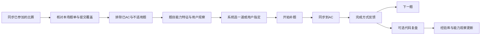

# 智能补题设计

> 2026-11-05 方向调整：此方案的候选池、资料准备和后续 RAG 工作流改为独立的「智能推荐」模块，不再限制为参加过的比赛。当前实现与接口以 [智能推荐设计](intelligent-recommendation.md) 为准。以下保留旧设计作历史对照，不代表当前接口与候选范围。

状态：候选池与题面资料准备已接入；AI 选题、题解准备及训练任务闭环尚未接入。版本：2026-11-05。最新整体方案见“动态候选池与 RAG 工作流”，题目分析职责见“学习价值优先的推荐流程”。与后文用户困难优先、固定四维加分、90 天硬门槛或“AI 不决定题号”冲突时，以最新方案为准。早期方案保留用于对照。本文中的阈值和权重均是待验证的产品规则。

智能补题从用户参加过、已经结束的比赛里，为用户挑选下一道值得补的题。候选包括尝试未通过和从未提交的题，后者通常更多。系统先挖掘题目本身值得学习的内容，再结合用户训练经历与难度比较。每次给一道题，完成后接回代码复盘与经验库。

## 动态候选池与 RAG 工作流

### 当前落地范围：候选与资料准备

入口为“补题准备”，使用独立 `UpsolvingPool` 和 `TrainingArchive`，不依赖房间服务内部状态。读取现有公开离线比赛题单和题面；不将 `.local` 实验结果或用户源码导入公共缓存，也不发起模型调用。

- 从已同步的正式个人参赛、OUT_OF_COMPETITION 和 CF Virtual 赛内提交发现已结束的参赛。Virtual 使用该参赛方的实际开始时间；缺少归属或开始时间的旧记录待核对，不按官方比赛时间猜测。普通 PRACTICE 不作为参赛依据。当前不能发现零提交参赛，也未接入本站 VP 房间的参赛来源。
- 先按已有 AC、同题资料严格一致的别名、日常训练中题目、评测中状态和难度排除，再保留最多 100 道候选，其余进入储备。未评级题待判断。此阶段仅为准备池，当前未见 AC 不表示已核对最新完整提交，响应 `selectionReady=false`；正式推荐前仍需同步校验。
- 原有合格候选优先留池，重新整理会补位；Rating 变化重查范围。题目移出候选后保留历史归属及公共资料缓存，内容哈希未变化不重写材料。当前没有开始、跳过、完成接口，不能将准备操作算作练习。
- 题面、题解、参考代码与分析状态分别保存或明确标缺失。首批只准备离线题面与样例，不把样例充当题解或隐藏测试，不声称已获得参考答案代码。
- 页面默认读取已有准备结果，不自动跑网络或模型。“整理已有记录”本地计算；“同步 CF 并整理”更新绑定账号最近最多 1000 次公开提交，再计算候选。失败保留旧池；旧数据有更新时提示重新整理。

当前接口：`GET /api/upsolving/pool`、`POST /api/upsolving/prepare`、`POST /api/upsolving/sync`、`GET /api/upsolving/material?id=...`。写接口只接受空对象，不允许前端传入 Rating、tag、用户 ID 或指定候选；材料读取验证当前用户的候选历史归属。公开对象不含算法标签、内部价值卡或个人源码。

存储表为 `upsolving_preparations`、`upsolving_pool_entries` 和 `upsolving_public_materials`。这些是准备层数据，不等同于后文待实现的推荐快照、个人适配、训练任务和能力画像。后续先补题解与参考实现材料，再接公共画像、私人适配和检索比较。

### 候选生命周期

从已参加、已结束的个人比赛收集未 AC 题目，先按比赛侧参考水平做难度准入，再维护每用户目标容量约 100 的候选池。100 是容量目标，不是最低数量；实际只有六道合适题就保留六道，不混入已 AC、太难、太简单或未参赛的题凑数。

推荐池、正在训练、冷却、已完成及未入池的储备队列分开保存。开始和跳过只改变推荐资格，不删除题目画像、私人适配分析、原始材料及历史原因。模型分析的潜在学习价值不是用户已经获得的经验，不能因展示、点击或跳过而写成掌握记录。

开始后从池里退出并补充下一道；每用户只允许一个正在训练任务。跳过后退出池并记录冷却期；到期恢复入池资格，池满时进入储备，不抢占正在展示的题。AC 以同步层提供的用户、题号和提交身份一致的真实结果核对，不能由客户端传入 done 伪造。状态操作须支持幂等、版本检查和用户隔离。

粗筛后每题分别建立公共题目画像与该用户适配分析。后台渐进准备，有多少合格题就处理多少；新材料准备不阻塞既有训练。候选失效时补位；Rating 变化重查候选资格，已经开始的题继续保留进度。

### 分层缓存与更新

| 层 | 键和内容 | 更新方式 |
| --- | --- | --- |
| 公共材料/题目画像 | 平台题号、正文与代码哈希、提示词版本 | 材料改变才重新分析，不因用户换题失效 |
| 私人适配 | user_id、题目版本、相关经验内容及状态、适用偏好 | 保存输入依赖和原文，按影响范围失效 |
| 推荐快照 | 用户、当前候选版本、检索结果与最终比较 | 已展示结果不随刷新重新生成 |

经验变化时，既检查以前依赖它的题，也重新检索可能新相关的题；只检查旧依赖会漏掉新匹配。全局偏好、参考水平变化可能影响许多候选，不能承诺永远只改一两题。即使个人适配需广泛刷新，公共题目画像仍可复用。

缓存应按影响判断的内容签名和版本记录区分失效。只是审计时间或不相关字段变化，不应重新调用题目分析。无关或弱关联结论也保留依赖，修改经验适用条件后可能需要重查。私人缓存不能跨用户共享。

### 检索与个人适配

1. 题目画像按一至两个学习价值分别建索引，保留原文 ID。使用本地多语言向量检索与 BM25 关键词检索，再按名次融合；每题取最相关片段，避免长文因片段多而占优。
2. 每题查找相关的用户经验，再由 AI 对照真实适用条件，区分直接相关、可迁移、弱相关和无关。小经验库先全读；初始界限设为八条，避免两条经验还强行只取一条。数量增加后才取检索 Top K。
3. 保存用户适配时，不把检索相似度当训练价值，不把 confirmed 当作缺陷根因已证实。pending 经验可供探索，但不能变成稳定弱项或强个性化理由。
4. 每次推荐从经验、明确偏好和训练记录生成少量需求，在当前候选池里检索；在检索阶段先限定用户、候选状态与档位，而非事后才排除跳过题。
5. 检索结果按题去重，目标 Top K 初设 8～12；候选不足则全部保留。另保留少量依据一般学习价值进入的题，避免只推已经熟悉的内容。旧个性化摘要中反复提到用户经验的话，不直接作为检索加分项，以免自我重复造成虚假高相关。
6. 最终 AI 比较读取候选价值、必要原文及经过准入的个人关联，输出每道题的优先档位及理由。Top K 是成本控制，不是把最相似的片段直接认作最值得练的题。

### 排序前的资料准入

逐题适配模型说“弱相关”，排序模型仍可能强行把它升级为迁移经验。正式流程需要在组装排序上下文时处理：没有通过条件检查的关联不提供为可用个人依据；如果没有有效联系，就用题目自身价值比较。原始无关经验也不无条件塞给排序模型。

排序对象区分被考虑过的经验与真正支持推荐的经验。只有明确使用的、来源有效的个人依据才进入公开 reasonCode。若模型自称 general，却附了无关经验 ID，不把它们作为推荐证据；如果明确声称 transfer/direct 却没有允许的证据，则拒绝该个性化判断，不能悄悄改成已验证的泛化结论。

公开理由由受控字段生成，解法、tag、关键常数、内部学习价值原稿留在赛后。相近候选允许同等优先，按既定难度贴合和参赛时间规则决定展示次序；这不意味着 AI 已证明唯一最优。候选遗漏、重复或越权题号不发布，改用仍有效的缓存或基础选择。

### 动态池实验结果（本地原型）

本轮使用六道真实候选、两条实际经验（其中一条待确认），并用 130 个明确标为 fixture 的模拟 ID 测试目标容量 100 的状态机。没有扩大用户的真实题池，没有改动生产数据库。没有保存明确偏好，因此偏好实验只使用单独标识的反事实样例。

- 完成 16 次非思考调用：六次公共画像、六次个人适配、四次排序对照。公共画像和适配结构检查不是事实正确性证明。
- 四个提前设定的已知目标检索诊断中，BM25、向量和混合方法均把目标排第一。这验证管线可用，但样本小且目标明确，不能据此宣称混合检索优于关键词或推荐准确率为 100%。
- 初版 Top 1 经验召回对六题都只取到经验 1，漏掉经验 2；本地策略已改为小库全读。修改后的六题适配尚未追加模型调用，不能声称已充分验证两条经验。
- 所有已获得的逐题关联均为弱或无关，其中一份重复输出经验条目被结构检查拦截。最终排序却仍有把这些关系升级为个性化依据的情况，证明仅提示“不要强行匹配”不够。
- 将不合格经验移出排序输入并恢复固定候选顺序后，输入与已有“无经验”对照调用完全一致，可以复用该次结果。这是缓存回放，不是新的独立模型验证。
- 在已有输出中，纯一般性判断附带的无关经验 ID 被去除；声称具体迁移却缺少支持的判断仍拒绝。固定规则后的可用一般推荐为 2118E；模拟“推理为主、少实现”偏好对照倾向 2110F，但该偏好未写入用户资料。模型优先集合仍不稳定。
- 14 个本地检查通过：容量与补位、单一 active、幂等、过期版本、跳过冷却、保留分析、AC 归属、用户隔离、旧依赖与新语义匹配的失效、小库完整读取等。真实六题的经验版本变化演示使六份适配都失效，因为它们都读了同一经验；公共画像重算为零。不能把这个结果说成只失效了少数几题。

现阶段可采用的是分层、缓存、检索和准入流程；推荐质量仍需更多新题与真实反馈验证。AI 对题意和解法仍会概括过度，正式功能尚未接入。全部实验脚本、个人数据与报告位于忽略目录；不自动提交。

## 学习价值优先的推荐流程

用户已明确：推荐的中心是挖掘题目的“值得推荐的地方”，不能把没有做过的题当作等待诊断的代码。已有 WA 源码是可选资料，不是补题推荐成立的前提，也不优先把问题理解成用户缺陷。

### 流程与职责

| 阶段 | 输入 | 输出 | 缓存与触发 |
| --- | --- | --- | --- |
| 1. 确认候选 | 已参赛题单、完整性、当前 AC、难度与冷却 | 合法的常规/挑战候选 | 提交和参赛状态变化时更新 |
| 2. 准备题目资料 | 题面、题解、附带代码、相关前置版本 | 带来源与缺失说明的资料包 | 原文或来源变化才重取 |
| 3. 提炼学习价值 | 单题资料包，不提供个人 WA 或旧弱项标签 | 1～3 条具体学习价值及依据 | 每题材料与提示词版本缓存 |
| 4. 关联个人经历 | 价值卡、已通过题目、必要的历史材料、反馈 | 适配依据、未知项与可能重复 | 不要求候选题有用户源码 |
| 5. 比较候选 | 所有小规模候选的价值、原文与个人联系 | 档内排序、取舍与推荐题 | 资料齐全后一次比较，快照复用 |
| 6. 推送与反馈 | 已核对题目、无剧透公开理由 | 一道题及开始/换题操作 | 真实 AC 与完成方式影响后续 |

小候选池逐题理解，再一起比较。只有数量或材料体积超出预算时才检索缩小范围；“用了 RAG”不是验收目标。不能因题目没有题解附带代码而直接淘汰，只降低实现工作量判断的确定程度。

### 学习价值卡

每题提炼 1～3 个突出之处，不强制填满固定维度。可关注关键观察、方法迁移、思路进阶、知识衔接、效率改进、代表性和综合训练，但必须解释本题具体体现在哪里。

每条价值保存：

- 材料事实：题解提供了什么转化、步骤、证明或参考实现。
- 学习收获：练习这种转化或推理可能积累的可迁移经验，这是教学判断。
- 前置基础与解法范围：适用于哪种路线，有无较简单的其他路线。
- 原文依据：题解段落、代码位置或题面条件；引用真实存在不等于教学结论已验证。
- 不宜优先的情形：思路已经反复练过、前置跨度过大、收益只来自某条可选路线等。

另存思考与实现的相对负担、资料缺口、无剧透表达。没有参考实现不估计代码行数；不能仅凭很长的模板判定实现训练价值。除非有依据，不把题目称为“经典必做”或“公认最优练习”。

### 个人适配与排序

先问“题目为什么值得练”，再问“用户现在是否适合练”。已 AC 只说明存在通过记录，不自动意味着掌握；缺少同类记录不代表不会。关联可来自有材料支持的前置题、近期练习的重复程度、明确反馈或旧经验，但允许结论是“通用价值明确，个人适配依据有限”。

模型应区别题目普遍的学习价值与个人专属的推荐依据。不能为了给用户一个特别理由，从题名、tag 或单次判题结果推断掌握情况。没有个人联系时，仍可比较难度合适的候选，但公开理由不能假装高度个性化。

常规和挑战分别比较，保留难度准入。模型可以改变同档基础排序；若两题接近，要说明取舍，不伪造精确收益分或通过概率。用户已有尝试可加以考虑，但不能压过未提交题本身的学习价值。

推荐时公开理由只描述训练形式和适配程度；关键性质、算法名和具体解法留在内部价值卡。实验结果页若提供内部内容，必须放在用户主动展开的“含题解信息”区域，不能发送到正式推荐响应中。

### 首轮验证方案

使用现有六道候选的相同快照，不依赖用户 WA 源码。逐题分析时不传 Rating 或用户信息，以减少“高分必然更值得练”的诱导；排序阶段再提供真实难度档位和个人历史。

最多八次非思考调用：六次题目价值分析，加两次相同资料、相反候选顺序的独立排序。第二次不看到第一次结果。保留原始输入输出、引用检查、费用用量和失败状态，不自动追加付费重试。

检查价值是否具体且对应原文、是否仍强行诊断用户、是否依赖不存在的候选源码、是否混淆题目价值与个人适配，以及交换候选顺序后的稳定性。顺序一致只说明这个样本上的一致性，不能证明推荐更优。与基础排序对照，但排名发生变化本身也不是成功指标。

本轮六题以前参与过材料提取实验，因此属于设计探索集，不是独立测试集。是否有训练收益仍需未见题目、真实补题过程和完成方式反馈来验证。

### 首轮结果与下一版约束

已完成六次题目价值分析、两次顺序相反的排序，均为非思考调用。材料覆盖六题的题面与题解，其中三题有题解附带参考代码；没有发送候选题的个人源码。实验数据与结果页仅保存在 Git 忽略目录。

结果是价值描述更具体，但自动排序未达到可发布要求：

- 六份卡片中三份通过逐字引用检查；其余存在公式格式变化或意译被当成引文的情况。引用通过的卡片也出现将题面“已着色”写成“未着色”的事实错误，因此引用存在不能替代语义判断。
- 原顺序排序漏掉一道候选，被完整性检查拒绝；反向顺序覆盖完整，前两名交换。两次都认为前两名接近，但这不足以声称排序稳定或推荐收益更高。
- 排序模型根据历史题名补出了未经材料支持的训练类型，不能据此形成个人适配结论。
- 自由生成的公开理由包含算法、关键观察或解法步骤，本轮没有采用任何一条作为正式推荐文案。

据此收窄下一版流程（设计调整，尚未再次模型实测）：

1. 每题优先提炼一至两个核心价值；难版必须区分继承自易版的内容和新增收获，避免把前置基础重复算作新收益。
2. 个人输入分为一般背景与有材料支持的关系。只给出题名和 AC 的记录不能支持方法熟悉度；需要解释某段历史时，再取对应材料。可明确给出“前置版本曾 AC，掌握程度未知”。
3. 排序输出为固定候选 ID 的逐项判断，服务器核对完整性后才生成有序结果。价值卡暂不可用时，仍保留候选和原文；漏题、重复题均不发布。
4. 公开理由用受控的训练形式及真实关系字段生成。自由文本的解法分析只留在内部，不能依靠“不要剧透”一句提示词直接发送给用户。
5. 模型认为候选接近时记录同等优先倾向，使用既定的难度贴合、参赛时间等规则确定展示顺序；不能对外声称 AI 精确证明某一道最优。

本轮未改变生产推荐和数据库，未证明优于基础排序。下一轮应在未用于提示词调整的新题上验证这些约束，而不是继续迎合当前六个题号。

## 早期方案：材料驱动的 AI 选题

本节是新的待实现方案，不代表已验证有效。核心改变是：规则负责候选合法性与难度档位，AI 读取题面、题解、代表代码及个人提交过程，比较候选的具体训练价值并提出排序。最终服务核对题号、AC、冷却及材料版本后保存推荐快照。题目推荐不再主要依赖四个宽泛的能力等级。

目标是找到“当前值得投入的一步”：继续完成已有尝试、复习历史困难、从已掌握的步骤向新步骤进阶。它们是系统内部考虑的理由，不新增用户必须选择的模式。未提交题可以因进阶价值胜出；有 WA 不一定更值得补，也不承诺 AI 能准确判断距离 AC 还有多远。

### 1. 每道题保留材料包与解法路线

| 材料 | 必须保留的信息 | 在推荐中的用途 |
| --- | --- | --- |
| 题面 | 正文、约束、公式、样例、图、交互协议、版本与来源 | 限定问题实际要求，避免忽略条件或读错版本 |
| 题解 | 按题和解法分段的原文、前置版本、图示、证明及复杂度 | 识别关键转化、成立条件、路线间的差异 |
| 参考代码 | 来源、语言、对应路线、函数/行定位、评测状态是否已知 | 看清实际操作、状态更新、边界处理与核心代码负担 |
| 用户该题提交 | 原始 verdict、时间、各版本源码及真实差异 | 判断已有尝试采用了什么路线，哪些步骤仍不明确 |

题解代码不自动等于经过核对的 AC 代码；模型生成的示例代码也不是参考答案证据。优先使用可获取的题解附带实现及用户授权源码。缺少参考代码时仍可从题解分析步骤，但实现负担标为较弱依据，不让缺代码的题永久丧失推荐资格。

每种路线保存：关键步骤、步骤依赖、需要保持的关系、常见操作、特殊条件、题解与代码的对应位置。每条结论区分原文事实、AI 解释和未知项。相同 tag 不自动意味着相同操作；不同 tag 也可能训练同一种操作。

代码按功能段阅读，引用保留原始行号及必要的调用、初始化、类型定义上下文。对模板部分另行标注，不删除原始代码。统计有效长度仅作辅助，不把长代码直接当高训练价值。存在另一条明显更简单的解法时，不能声称复杂路线上的要求是题目必需能力。

### 2. 个人历史形成具体学习记录

记录单位是一次题目过程，不是一次模型输出。每条记录包含：问题与日期、实际代码改动、可能涉及的操作、已知完成方式、替代解释、后续类似表现及来源。已有经验卡作为索引，必要时返回原提交，不把卡片文字当权威事实。

示例：“合并前新增同集合判断，避免相同对象再次累计权重”；比“边界能力偏弱”更适合匹配下一道题。代码差异可以支持改动事实，但不能仅用 WA→AC 证明唯一根因。

历史记录不因超过 90 天直接失效。旧记录可以提出复习或检验建议，必须带日期和不确定性；多道近期同类困难可加强依据，后续有材料支持的独立完成可削弱旧困难。只有一条历史观察也允许成为推荐线索，不因此给用户贴稳定弱项标签。首次提交 AC 仍不能推出独立完成。

候选题已有个人提交时，优先考虑该题材料：用户路线与题解路线是否一致、已实现哪些关键步骤、未解决的是具体实现疑点还是较大的思路差异。不同路线不能按文本 diff 强行找“少写了哪几行”；无法判断时明确未知。

### 3. 小候选池直接读，大候选池再检索

先按参赛、AC、难度档位和冷却建立合法候选池。当前六道题足够逐题读取资料、缓存理解结果，再把全部候选的分析摘要与关键原文提供给排序模型；不必为了使用 RAG 先丢掉候选。资料是否超出上下文按 token 预算判断，不只数题目。

大候选池采用多路召回：个人具体困难、该题已有尝试、已完成前置版本和可复用步骤，分别检索。使用自然语言语义检索结合关键词检索，先限定用户候选集合，再按题目与解法路线聚合结果。基线较优、有赛内尝试或资料稀缺的候选也保留一定覆盖，避免只推资料最多的题。

题面、解法步骤、代码功能段分别索引，不把整道题压成一个向量。片段附上题号、路线、作用和必要条件；召回片段后再取完整所在章节、函数及依赖，而非让模型只凭一句相似的话选题。中英文描述可以生成双语检索摘要，原文始终保留；翻译摘要不作为新的事实来源。

通用 reranker 可帮助筛选相关材料，但它的相似度不是教学价值分。最后仍由带个人历史与原文的 LLM 比较候选。暂不训练新模型，也不为小候选池引入复杂图数据库。

### 4. 匹配结论必须包含可追溯的联系

每条“用户—候选”匹配输出以下内容，而非只有分数：

- 用户依据：哪一次具体过程、哪处改动，或者哪些已完成前置步骤。
- 题目依据：哪条可行路线的哪一步，需要怎样的操作。
- 训练联系：该步骤如何复习旧困难或增加一项新要求。
- 不适合的可能原因：旧困难已过时、另一路线绕开训练点、难度跨度过大、材料不足等。
- 推荐用途：继续完成、复习检验、进阶训练，及证据是当前观察还是历史线索。

通过概率、节省时间、提升 Rating 不由模型直接编造。匹配强弱是当前材料上的判断，不是校准后的成功率。

### 5. AI 排序真正影响选题

在同一允许的难度档位内，AI 对候选进行比较，决定先补哪一道。难度更接近 R 不必然获胜；若某题与个人具体困难联系更清楚，可以优先。反之，只有泛泛的标签关联，不能压过另一题直接的个人过程依据。

初版一次比较少量候选，返回有序题号、对应的匹配依据及主要取舍。有争议的前两名才进行一次有针对性的比较，允许同等合适，不扩展成所有题两两比较或无限自我审校。评估时交换候选顺序，检验位置变化是否改变结论。第二次模型赞同不等于事实被验证。

验证程序仅检查来源存在、题号属于候选、引用位置有效、返回格式和当前状态；不以这些检查冒充算法正确性验证。材料关键缺口无法解决或输出不可用时回退基础推荐。刷新复用已保存的快照，不重新抽取排序。

### 6. 有边界的资料工具

| 内部工具 | 返回内容与限制 |
| --- | --- |
| list_eligible_problems | 系统筛选的候选、来源比赛与覆盖；模型无权扩大到已 AC 或未参赛题 |
| get_problem_materials | 指定候选的题面、路线、题解、参考代码、缺失状态和来源 |
| get_user_attempts | 当前用户该题的提交序列、源码与差异；用户作用域由服务端固定 |
| search_learning_history | 检索当前用户具体学习记录，返回正反例及时间，不只返回失败 |
| search_candidate_materials | 仅在合法候选内查步骤、正文及代码片段，按题目聚合 |
| expand_evidence | 按已提供的来源 ID 补上下文；图或 PDF 返回对应页/图片及文字，无法识别则标缺失 |

工具返回资料版本、可定位原文和缺失原因。网页、代码注释及题解内文本作为资料，不作为可执行指令。共享题目材料与私有用户记录分开存储和检索。

题面图与 PDF 页采用视觉识别时，要核对题号、图与正文的对应关系；公式优先保留原 LaTeX。纯文字提取失败不能被记成空题解。不是每份 PDF 都交给视觉模型：文字可读时先按题号分段，图或公式缺失时再读取对应页。

### 7. 缓存、费用与用户体验

题目理解按材料哈希、路线和提示词版本缓存；用户过程按提交序列缓存；只有候选或相关个人记录变化时重新匹配。旧版本结果保留供实验对照。继续使用已有非思考模型配置，不因设计修订自动开启长思考或付费调用。

资料已缓存时，初版目标为一次排序调用，必要时最多一次补充判断。冷启动每个缺失题目包需要额外理解调用，不声称全部流程只花两次。实际 token 上限、模型调用额度与队列等待单独记录，任何实验预算都是上限而非必须用完。

用户仍然只看到一道题、比赛来源、难度和无剧透理由。内部步骤匹配与源码证据放在赛后复盘；推荐 API 不返回这些内容，避免仅在界面隐藏却提前泄露。跳过是偏好或时机信号，不等同于不会做；真实 AC 与完成方式反馈更新后续判断。

### 8. 如何证明材料确实有用

使用未参与提示词调整的题目和用户过程，固定相同候选池，比较：

1. 难度、尝试与时间的基础排序。
2. 加入题面、题解与参考代码的排序。
3. 再加入用户具体提交过程与历史学习记录的排序。

检查推荐依据是否对应真实操作、是否混淆可选路线、是否忽视后续成功、是否同题异号、移除关键材料是否改变理由，以及交换候选顺序后的稳定性。离线历史评估按时间截断，不能把未来 AC 代码或后来复盘泄漏给当时的推荐器；今天推荐则可使用今天之前的合法历史。

这些检查可由项目组抽样评审，不成为用户每次推荐的确认步骤。真正的训练收益继续观察实际补题过程、完成方式以及不同题上的后续表现，不能仅让模型评价自己的推荐。单个用户的六道题不足以证明整体优于基线。

### 方法参考与适用边界

- [Contextual Retrieval](https://www.anthropic.com/research/contextual-retrieval)：借鉴为片段补全文档上下文、结合关键词与语义召回的做法；其检索实验收益不直接代表本项目的训练收益。
- [Qdrant Hybrid Queries](https://qdrant.tech/documentation/hybrid-queries/)：可实现多路召回与多阶段重排；是否引入向量服务按候选规模决定。
- [Pairwise Ranking Prompting](https://aclanthology.org/2024.findings-naacl.97/)：借鉴候选相对比较，不能把文档相关性实验结果直接外推为学习价值。
- [Large Language Models are not Fair Evaluators](https://aclanthology.org/2024.acl-long.511/)：排序评估加入顺序交换，不把一次模型偏好当稳定结论。

## 已确定的产品边界

- 保留两个入口：自动推荐、指定比赛。自动推荐的比赛范围、难度策略与排序由系统决定，不提供过滤器、权重、标签、关注方向等用户设置。指定比赛允许选择比赛和题目，其选择不成为自动模式的限制条件。
- 用户仍可以开始、换一道、暂时跳过、恢复之前的题。操作影响当前进度和短期冷却，不等同于用户配置推荐算法。
- 日常练习独立；补题与未来 VP 位于同一个训练入口，使用比赛侧参考水平。两侧不互相写入水平调整。
- 推荐页不显示算法 tag、题解、关键解法、反例或源码。能力训练理由采用概括表达，避免提前给提示。
- 同步到真实 AC 才能标记题目已通过。开始过本站补题的任务，在 AC 后必须反馈独立完成、参考提示或参考题解。AI 复盘和收藏经验可选，不阻塞下一题。
- 停止推进经验卡检索新题功能；保留经验库和现有代码复盘。这里不依赖旧实验脚本，不建设全题库向量搜索。
- 首期 CF。其他 OJ 通过能力声明和归一化接口接入；缺少题解、源码、难度或参赛历史时逐项降级。

## 用户流程与页面

自动推荐页只有当前题目、来源比赛、优先级、简短理由、操作和同步状态。题目若已开始，刷新或后台更新不能替换它。

指定比赛页显示最近比赛列表，可以选择更早的比赛。单场题目依次显示赛内已通过、赛内尝试未过、赛内未提交、赛后已补完和记录待核对。优先补题、可以挑战、暂时跳过是待补题的建议层级，不是完成状态。



页面示例均使用虚构训练赛，不代表用户真实记录。对应可打开的[交互设计预览](smart-upsolving.html)。

### 推荐展示

> 优先补题 · 训练赛 A 的 C 题 · 1800<br>
> 赛内有未通过提交，难度处于适合继续训练的范围。<br>
> 开始补题 / 查看原题 / 换一道

有足够个性化依据时，增加“适合继续训练实现稳定性”这样的宽泛理由。内部的“撤销后更新计数”“区间边界”等细节不提前展示。能力证据详情放在个人画像或赛后复盘中。

空状态区分：没有发现参赛记录、正在补全历史、尚有记录待核对、当前没有适合自动推荐的题、所有已知候选已通过。不同状态给不同提示，不把服务失败说成没有题。

## 比赛发现与数据真实性

### 发现参赛记录

第一版以评级参赛历史、提交中的正式/虚拟参赛信息、未来本站 VP 记录三类证据发现比赛。普通练习提交不能证明用户参加过该场比赛。用户指定比赛时可以明确建立手动训练记录，但不伪造历史参赛或历史赛内表现。

CF 普通公开比赛榜单当前只允许匿名请求 `contest.standings?contestId=...`，返回完整正式榜单；不能沿用给它加 `handles`、分页或 `showUnofficial` 的做法。Gym/mashup 需要有访问权限的认证请求。评级历史和提交列表分别承担发现比赛与查提交的职责；这些接口不保证发现零提交 VP。接入时再次核对接口能力。[CF 方法说明](https://codeforces.com/apiHelp/methods)

提交的参赛类型、创建时间、相对开赛时间以及参与方开始时间用于定位一次参赛；比赛时长和结束状态用于判断边界。必须保存这些原始字段，不能只保留题号和 verdict。[CF 数据结构](https://codeforces.com/apiHelp/objects)

同一比赛的不同 VP 分开建参赛记录。优先使用明确的参与方开始时间；可用提交时间减相对时间交叉核对，不能在缺失时间时拼造精确赛程。不能可靠定位的记录标为待核对。用户在第一次参赛前已通过的题，不作为后来 VP 的首次学习样本。

### 覆盖与时间边界

- 题单必须来自这场比赛，不能只从用户交过的题拼出题单，否则永远发现不了未提交题。
- 正式比赛使用实际参赛窗口；VP 使用该次虚拟开始与结束窗口，不能拿原比赛年份当 VP 时间。
- “赛内未提交”只在本场提交覆盖已确认时输出；否则是“赛内提交记录待核对”。不把未提交描述成没读题、没写代码或不会做。
- “当前尚未 AC”按已同步数据判断。自动候选被展示或开始前，再按用户和该比赛分页核对提交；成功后记录 `verifiedThrough`。无法核对时保留上次状态并标明时间，不以空列表覆盖原数据。
- CF 提交暂未完成评测、比赛未完成终测、榜单冻结、重测进行中时，不把当前 OK 或零分当最终学习结论。暂缓自动推荐相关题，允许查看记录。
- 赛后已有最终 AC 的题从所有相关比赛的待补队列移除；赛内结果仍保留。经过重新评测失去 AC 时重新核对，而非永久保留已完成缓存。
- 个人、团队参与明确区分。团队通过可以标记团队赛结果，不能直接归为用户个人独立完成或能力进步。第一版团队赛仅在指定比赛中展示，不进入个人能力自动训练。
- 同题在不同比赛使用的别名，仅依据已确认映射归并；不凭相似标题合并。自动候选按平台和规范题目 ID 去重，保留全部来源比赛。

### 同步规模

自动模式的候选范围是全部已发现、符合条件的历史比赛，不固定最近五场。实现采用渐进同步：先处理最近参赛记录，再每个后台批次补充至多五场更早记录。发现列表完整性、题单完整性、本场提交完整性分别记录。页面显示覆盖进度，不声称扫描了全部历史。

自动推荐不要求首次进入就抓完历史。已确认部分可先给推荐；后台扩展不能替换已展示或已开始的题。API 请求走现有共享限速、缓存与去重；403/429、鉴权失败或分页重复时停止对应任务，保留已获取内容。

## 题目能力特征

内部特征描述“采用某种受支持解法时需要做什么”。一个长实现不能证明所有正确解法都很长；多种解法分别记录，标记共同要求与路线特有要求。

每个维度使用 `unknown / low / medium / high`，同时保存依据、材料覆盖、适用解法、分析版本。unknown 不是 low，不转为数值零参与弱项统计。等级不是题目难度，也不是用户成功概率。

| 维度 | 观察内容 | 必须避免的误判 |
| --- | --- | --- |
| 实现组织 | 有效逻辑量、相互依赖的模块、分支嵌套、特殊处理分散程度 | 以代码行数或语言判断难度；把常用模板算成核心逻辑 |
| 状态维护 | 不变量、多个结构同步更新、修改/撤销/重置的先后依赖 | 看见 set、map 或长变量表就判定高需求 |
| 边界分类 | 空/单元素、重复、等号、端点、奇偶是否影响正确性与分支覆盖 | 凭题型想象特殊情况，或把多个 WA 直接归为边界错误 |
| 性能实现 | 解法复杂度、热点循环、重复计算、空间规模、输入约束要求 | 仅凭 TLE 判断常数差；比较不同运行环境下的毫秒数 |
| 顺序依赖 | 先查询还是先修改、DP 遍历方向、离线事件顺序 | 认为一切带循环的题都存在顺序陷阱 |
| 数值处理 | 中间量范围、整数取整、取模、浮点稳定性 | 以出现 long long 或 double 作为充分依据 |
| 建模转化 | 从题意到状态/图/等价表示的关键变化 | 根据没有提交判断用户建模差 |
| 正确性论证 | 不变量、交换论证、可行性必要条件、关键反例 | 把模型自己的解释当成已经证明的定理 |

首期只让前四项参与个性化加分；其余字段预留，材料支持时记录，不急于给用户评分。

### 实现复杂度的专门处理

1. 保留原始代码，不修改或执行用户程序。度量使用单独分析视图，识别注释、空行、通用模板、未使用段和题目核心代码。
2. 有效 token 数、控制流和模块间依赖仅作为辅助。首期无需自行实现跨语言 AST；词法统计难以处理的语言标未知。
3. 官方代码、多个可合法获取的解法可交叉比较，但不自动批量获取其他用户私有源码。只有一份解法时注明单一实现覆盖；篇幅长本身不给 high。
4. 题解中的伪代码和正文可以支持算法步骤判断，不能替代缺失的实现性能证据。
5. 不同解法的能力需求冲突时不取最高值。共同要求可直接用于题目特征；只在某一路线存在的要求降低个性化权重，不能承诺用户一定练到。

例如，题解代码 230 行，其中 160 行是模板，余下逻辑没有多处同步更新，不应被列为高状态维护需求。另一份代码只有 75 行，但每次删除需要维护三个相关计数和一个有序集合，反而更值得关注。

## 用户能力观察

第一版不展示未经校准的八维能力分或雷达图。显示“近期关注”“样本不足”“近期表现稳定”，每项附不同题目的样本数和可回看的复盘依据。

### 观察来源与归因

主要依据用户自己的提交顺序、代码差异、题面及已完成复盘。现有经验卡可作为证据索引，但用户收藏或 AI 生成一张卡，不自动证明存在稳定弱项。

| 观察 | 可以形成的记录 | 不能直接推出 |
| --- | --- | --- |
| 同一算法下，WA 到 AC 修改了已识别的不变量维护 | 一次状态维护困难观察 | 该修改是唯一根因，用户长期状态维护能力低 |
| 多道题的修复涉及遗漏的边界分支 | 重复边界处理观察 | 所有未通过题都是边界问题 |
| TLE 到 AC 改变了渐进复杂度 | 算法效率方向的观察 | 容器分配或代码常数一定有问题 |
| TLE 到 AC 保持主要算法，减少明确重复工作 | 性能实现观察，带解释边界 | 已通过运行测试证明性能根因 |
| 阅读题解后 AC | 学习方式为参考题解 | 本次训练失败、能力下降 |
| 第一次提交就 AC | 观察到一次成功 | 一定独立完成、没用提示或源码 |
| 比赛无提交、很晚才提交、多次换题 | 客观行为记录 | 实际投入时间、思考时长、没有思路或注意力不足 |

### 形成近期关注项

初版采用保守的重复观察规则，而非成功率模型：

- 时间窗为最近 90 天，至多 30 道不同题；只对与当时参考水平相差不超过 400 的、有该维度材料的题形成主要能力证据。没有当时参考水平的历史记录可展示，但暂不参与能力加分。
- 新训练直接保存当时参考水平。历史材料可用提交之前最近一次官方 Rating 记录作为近似参照，明确来源为官方历史而非本站当时的动态水平；不能使用提交之后的 Rating 回填，完全无依据时仍标未知。
- 同题同维度只贡献一次观察，不按 WA 次数、复盘次数或重复 VP 放大。后续更完整的记录替代旧观察，而不是再加一次。
- 至少 5 道可比较且有材料的题，其中至少 3 道出现同类有依据的困难，才进入“近期关注”。这些门槛是待实验调整的规则。
- 达到门槛前仍可给基础补题推荐，不为了生成画像反复调用模型。
- 不同维度可以同时解释一处修改，保存多种可能原因，但不能把同一证据当成多项已确认根因。证据不足时只记录“需要关注”，不影响排序。
- 观察依赖一个算法路线时标注范围；来自完全重写或缺少中间提交的材料，不强归因到实现细节。
- 新近独立完成相似能力要求的不同题，会降低困难权重。连续三道有覆盖的独立完成样本，可将关注项转为“观察中”；保留历史而不立即宣称掌握。
- 使用提示或题解的完成记录不能记为独立表现，但也不能作为新的负面能力证据。

对题目特征、用户观察、匹配结论分别保存证据。模型不能凭自己的“置信度 0.9”越过材料缺失。复杂度和缺陷根因仍属于 AI 分析，不增加编译、运行测试或人工确认流程。

## 系统如何选择下一题

### 第一步 可用候选

必须同时满足：参赛有依据且已结束、个人训练可归属、本场题单已获得、当前未见最终 AC 且候选提交核对成功、题目可访问、不是本站正在进行的同题、未处于冷却。仍在评测或原比赛未完成终测时暂缓。

指定比赛模式允许用户自行选远超推荐难度的题；自动模式不接收比赛 ID、难度、标签或权重参数。两种模式不混用用户选择条件。

缺少难度的题保留在指定比赛的“待判断”中，首版不自动推荐，不用 1800 冒充题目难度。1800 仅是无官方 Rating 用户的初始参考水平。

### 第二步 难度层级

设比赛侧参考水平为 R。独立存储，初始来自当前 CF Rating，无评级时 1800；官方 Rating 真正变化时更新。首版补题不调整 R：补题时长和参考题解反馈不能直接模拟比赛能力；未来 VP 调整另行实现。

| 题目难度相对 R | 建议层级 | 自动模式 |
| --- | --- | --- |
| R−400 至 R+200 | 优先补题 | 常规候选 |
| 高于 R+200 至 R+600 | 可以挑战 | 有控制地进入候选 |
| 低于 R−400 | 暂时跳过 | 训练收益可能偏低，不自动推送；指定模式可选 |
| 高于 R+600 | 暂时跳过 | 难度跨度较大，不自动推送；指定模式可选 |
| 难度缺失 | 待判断 | 不纳入自动排序 |

“暂时跳过”不等于已经学习过、永久不推荐或用户主动跳过。随 R 与信息更新重新判断。缺少数据和暂时不适合训练分开显示。

自动模式通常选优先补题；每完成三道常规补题，下一次可选择一道 R+200 至 R+400 的挑战题，前提是能力匹配有依据或近期已有独立完成表现。无此候选则仍推常规题，不为了凑比例硬上难度。只剩 R+400 至 R+600 的题时可以推荐并明确标为挑战，不宣称有很高完成概率。此节奏是首版实验策略，用户无需设置。

### 第三步 同层级排序

先做难度准入，再排序。AI 特征不能把明显过难的题推入常规层级。排序是可重放的规则，AI 不直接决定最终题号。

| 分量 | 初版定义 | 上限 |
| --- | --- | --- |
| 难度贴合 | 常规层内离 R 最近优先；挑战层内离 R+300 最近优先。分值 `max(0, 20−abs(rating−target)/20)` | 20 |
| 能力训练价值 | 最强一个已成立关注项：题目共同需求明确为 12；仅路线相关或证据一般为 6；无依据为 0。第二项最多再加 4 | 16 |
| 赛内投入 | 有最终 WA/TLE/RE/MLE 等实质评测为 8；只有 CE 为 3；未提交为 0。多次失败不累加 | 8 |
| 参赛新近程度 | 从该次实际参赛结束算：7 天内 6，30 天内 4，90 天内 2，更早 0 | 6 |
| 训练分散 | 最近三道已完成补题中有两道同一来源比赛或同一主训练维度时，对重复项减 4；累计最多减 4 | 0 |

没有能力材料时使用其余分量，不将空值当作能力需求低，也不生成个性化理由。分数仅用于排序，不显示为成功概率。赛内未提交题仍可胜出，不让尝试记录永久压住更合适的新题。

同分按难度贴合、实际参赛时间、稳定题目 ID 排序。推荐快照保留理由分量、依据版本与覆盖范围，刷新不会随机变题。新数据只影响下一次推荐；现有推荐失去有效性时，如外部 AC、题目撤回，才撤销并告知原因。

### 示例

用户 R=1800，状态维护是有样本支持的关注项。以下是虚构候选，不是对真实用户的判断：

| 候选 | 难度贴合 | 能力价值 | 赛内投入 | 新近 | 合计 |
| --- | --- | --- | --- | --- | --- |
| A，1800，只有长代码，没有状态证据 | 20 | 0 | 8 | 6 | 34 |
| B，1900，有明确多处状态同步要求 | 15 | 12 | 8 | 6 | 41 |
| C，1800，赛内未提交，有明确状态维护要求 | 20 | 12 | 0 | 6 | 38 |

系统推荐 B，而不是代码最长的 A。C 也能排在 A 前面。另一个 2600 的候选即使能力特征高度相关，仍在难度准入阶段被排除。

### 换题和跳过

- 未开始时换题：当天不再自动推荐，不制造尝试记录。
- 开始后暂时跳过：保存进度，当天不再自动推荐，之后仍可进入补题候选；这是补题池，不使用日常练习“包含尝试过的题”开关。
- 可立即从历史恢复，同题只保留一条补题任务。跳过原因可选，不能据此判定能力下降。
- 多次跳过可以带来短期降序，但首版不永久封禁、自动降 Rating 或删除旧题。

## AI 与资料处理

### 处理任务

| 任务 | 输入 | 输出 | 触发和缓存 |
| --- | --- | --- | --- |
| 题目能力分析 | 题面、按题分段的题解、可访问的代表解法及代码 | 解法路线、各维度需求、依据 ID、未知项 | 每题每材料版本一次；按需后台分析候选，不扫全题库 |
| 用户困难归纳 | 用户自己的 WA 至首次观察到 AC 过程或明确选定片段、真实 diff、已有复盘 | 具体困难观察、涉及维度、替代解释、材料覆盖 | 完整复盘后异步派生并缓存；不在打开推荐页时批量抓用户源码 |
| 规则匹配 | 已支持的能力特征、已成立的用户关注项、难度及参赛状态 | 层级、顺序、公开理由代码、内部匹配依据 | 本地计算，不调用模型 |

题目分析先描述实际解法与操作，再给特征，防止按用户弱项硬找对应关系。公共题解特征可跨用户缓存；从用户源码产生的特征和观察严格属于该用户，不提升为公共题目结论。

没有题解不阻塞基础推荐。仅题面不能支持性能实现等判断时，这些维度标 unknown。源码不齐、复盘失败或用户未配置模型时，仍可完成“参赛—补题—AC—反馈”。

首版不需要 RAG 向量数据库。候选来自明确的比赛集合；材料按题目 ID 精确定位，长题解使用章节切分和邻近上下文。可复用已验证的 PDF 分段思路，但不能把 `.local` 实验脚本直接当生产依赖。

### HTML PDF 与公式

统一资料段包含 `evidenceId / problemId / sourceUrl / contentHash / text / locator / quality / rightsScope`。HTML 保留公式和段落结构；代码块单独保存，避免模板淹没正文。

PDF 先识别题目章节，再做页内分题和跨页合并。正文原生文本优先，无法读取时才按相关页 OCR。保留原页图与物理页码；普通 OCR 的识别置信度不能作为公式正确性。

提取损坏会影响关键判断时，不向纯文本模型提供猜测修复后的公式。配置有可用视觉解析器则按页解析并保留出处；没有能力或仍不可靠则降级为 unknown，不要求用户逐题人工核验，也不凭题解代码长短补出缺失性质。

### 成本与失败

沿用 Flash 非思考，题目分析先按一轮结构化输出实现，每题最多 4000 输出 tokens；用户困难归纳优先复用已完成复盘，仅必要时补一轮，最多 2000 输出 tokens。后台每批最多分析 3 道候选；模型失败不自动无限重试。

模型提供方、单批预算、缓存失效和总调用上限属于服务端配置，不是用户的选题参数。设计阶段不发起付费调用；正式接入复用已有模型配置和用户数据使用范围。

校验维度枚举、题号、证据 ID、用户归属、源码行范围、材料版本和输出完整性；这些检查不证明语义正确。模型文本不能决定权限、运行程序或修改难度准入。解析失败不保存伪造的空特征。

## 状态与数据结构

题目状态与本站任务状态分开。赛内已过、赛后已过、尚未过是客观提交状态；recommended、active、skipped、pending_feedback、completed 是本站任务状态。

`recommended → active → pending_feedback → completed`；`active → skipped → active`。已开始后在外部 AC，同步后进入 pending_feedback；仅浏览过、尚未开始就外部 AC，直接归档为已通过，不补造训练开始时间或追加强制反馈。

一次 AC 在不同来源比赛中共同生效。每日练习和补题可以各有一题，但同一道题不能重复建立进行中任务：若另一入口已在练习，跳转已有任务；同一次完成与反馈在能力统计中只计一次。补题反馈不触发每日练习的三题水平调整。

建议新增的数据表，优先使用独立服务，不重写现有训练服务：

| 表 | 主要内容和约束 |
| --- | --- |
| contest_sessions | user_id、platform、contest_id、session_key、参与方式、起止时间、个人/团队、来源、覆盖状态；同次参赛唯一 |
| contest_problem_links | 一场题单与规范题目 ID 的对应、题号、已确认别名；与用户赛内表现分开 |
| upsolving_profiles | user_id、比赛侧 reference、官方 rating 版本、当前推荐和节奏计数；独立于 training_profiles |
| upsolving_runs | user_id、规范题目 ID、状态、开始/跳过/AC/反馈、来源参赛记录；每用户每题唯一，最多一条 active |
| problem_materials | 来源、文本或资源引用、章节/页码、内容哈希、解析质量、公开或用户私有范围 |
| problem_feature_profiles | 平台题目与解法路线、特征、证据、材料哈希、模型/提示词版本；私有来源必须带 user_id |
| user_skill_observations | user_id、题目、维度、提交/复盘证据、当时水平、困难/独立完成、时间、覆盖；同题同维度去重更新 |
| recommendation_snapshots | 用户、候选题、分数组成、公开理由、策略/特征/画像版本、创建与失效原因 |

来源归属可用关联表，不把多场比赛硬塞成题目的一个 contestId。状态修改采用用户作用域、事务和版本号；跨入口同题开始必须在同一写锁内再次核对。AC、反馈和后台派生观察均要求幂等。

## 接口设计

所有接口按登录用户作用域执行。自动推荐参数由服务端产生，客户端未知字段拒绝；不因客户端传入 rating、tag、contestIds 而改变策略。

| 接口 | 输入与职责 |
| --- | --- |
| GET /api/upsolving | 当前推荐、active、pending、近期进度、参考水平、覆盖/资料状态；不触发付费分析 |
| POST /api/upsolving/sync | 创建比赛与提交同步任务，返回 jobId；空输入 |
| GET /api/upsolving/jobs/{id} | 该用户任务状态、进度、已完成覆盖和可重试错误 |
| GET /api/upsolving/contests | 游标分页参赛记录；只服务指定比赛入口，不改变自动候选范围 |
| GET /api/upsolving/contests/{sessionId} | 题单、赛内/赛后状态、建议层级、覆盖；不返回 tags 或内部解法特征 |
| POST /api/upsolving/recommend | 空输入；返回持久化推荐或明确无候选原因，不提供用户策略参数 |
| POST /api/upsolving/start | recommendationId 或 sessionId+problemId（二选一）、expectedVersion；事务内核对参赛归属、AC 与已有任务 |
| POST /api/upsolving/dismiss | recommendationId、expectedVersion；未开始换题 |
| POST /api/upsolving/skip | runId、expectedVersion、可选简短原因；已开始暂时跳过 |
| POST /api/upsolving/resume | runId、expectedVersion；恢复同题任务 |
| POST /api/upsolving/feedback | runId、completionMode；AC 后必填且幂等。纠正已有反馈需显式修订接口并重算派生观察，不重复计入完成次数 |
| GET /api/upsolving/history | 游标分页任务历史，含来源比赛与真实 AC 依据 |
| GET /api/skills/observations | 当前用户的能力观察、样本数和来源；不泄露其他用户记录 |

公开推荐对象包含题目、来源比赛、level、reasonCodes、无剧透 reason、同步时点、推荐版本和开始权限。不给前端传内部 tags 再靠 CSS 隐藏；内部特征和解法不混入推荐响应。

```json
{
  "recommendationId": "opaque-id",
  "version": 3,
  "problem": {"platform": "codeforces", "problemKey": "external-id", "title": "题目名称", "rating": 1800, "url": "https://codeforces.com/..."},
  "sourceSessionId": "opaque-session-id",
  "level": "priority",
  "reasonCodes": ["difficulty_fit", "attempted_in_contest", "recent_training_match"],
  "reason": "赛内有未通过提交，适合继续训练实现稳定性。",
  "verifiedThrough": "timestamp",
  "coverage": "contest_verified"
}
```

适配器新增 `discover_participations`、`contest_problems`、`participant_submissions`、`problem_materials`，返回可用能力、覆盖、游标及来源，不将 CF 字段判断散落到 UI。材料可来自缓存、官方接口、网站公开内容或用户授权浏览器助手；不可访问不伪装为空题解。

## 与现有项目衔接

- `adapters.py` 当前归一化丢失 relativeTimeSeconds、参与方开始时间和团队信息，需要新增可空字段，保留原语义；旧记录无法补出的字段标未知，不能按同步时间回填。
- `problem_catalog` 当前过滤未评级题，不能直接作为完整比赛题单。新建比赛题单读取路径，允许 rating 为 null。
- 新增 `UpsolvingService`、`ProblemFeatureService`、`SkillObservationService`，分别负责训练状态、公共/私有题目特征、用户观察。不把网络抓取、模型调用放在 SQLite 写事务中。
- `save_records` 在保存后触发补题状态核对；AI 派生放后台，提交同步不必等待模型。
- 现有手动 `tasks` 清单与旧笔记保留。其手动 done 不是 AC，不能直接迁移成新补题完成。可以链接同题，实际进度重新依据提交判断。
- 侧栏保留日常练习；原补题计划入口逐步升级为赛后补题，同时保留“手动计划”入口。未来 VP 在同一训练区域新增页签。移除未开放的经验巩固占位，不删除经验库。
- `training_profiles` 和日常练习现有偏好不迁入自动补题。现有两轮代码复盘不在本次设计中重写。
- `.local` 数据、实验模型、个人源码和密钥继续忽略。设计与被正式采用的代码进 Git，本轮不自动提交。

## 实施顺序与验收

### 第一批 比赛到补题的完整流程

完成参赛发现、题单、时间与覆盖归一化、正式/VP 区分、指定比赛、基础自动推荐、AC 核对、反馈、跳过恢复。无 AI 也能使用。优先覆盖 CF 普通个人赛；Gym、团队与缺评级情况明确降级。

验收重点：赛后 AC 不再推荐；VP 不用原比赛时间；零提交不误判能力；分页中断不宣称无提交；重复参赛同题不重复；手动 done 不伪造 AC；自动模式无用户调参入口。

### 第二批 四项能力特征

对实际待补候选做按需题目特征分析；从已有完整复盘派生用户观察。接入首期四项排序和无剧透理由。没有证据时保留基础推荐，不堵住训练流程。

上线前固定一组材料完整的题和用户过程，由项目组对是否确有该能力要求给参考判断。至少覆盖模板长但逻辑短、代码短但状态耦合、算法重写、边界修复、仅 CE、无源码、缺题解等反例；不能把“模型全部拒绝”当作成功。

### 第三批 质量与效率

补全材料和公式解析、跨平台能力声明、更多解法路线、后台缓存和候选覆盖；视新增数据再开放数值、顺序、建模、证明维度。只有跨语言检索真实成为瓶颈时才考虑向量检索。

| 验证层 | 验收内容 |
| --- | --- |
| 功能正确性 | 用户隔离、状态幂等、参赛窗口、覆盖、重测、AC、别名、并发开始、跨模块反馈不重复 |
| 来源与结构 | 模型只引用提供的题目/段落/代码行；unknown不转低；PDF相邻题不串；私有特征不跨用户 |
| 选题价值 | 在固定、未用于调参的样本上比较基础排序与能力排序；看实际推荐是否练到对应能力，不只看文字解释流畅 |
| 产品体验 | 进入页无需等模型；刷新不换题；能看到为何推荐但不被剧透；缺数据时仍有可用路径 |
| 成本 | 同材料不重复分析；取消不继续发下一轮；调用和token可统计；失败没有无限重试 |

推荐点击率、换题率和 AC 率分别观察，不能把更多点击或更容易 AC 当作训练收益。是否独立完成、后续同类不同题是否减少相似困难，以及用户对推荐是否有用的反馈，才是后续验证训练价值的依据。

## 首轮真实数据实验后的约束

本轮实验覆盖 6 道候选的题面与题解、历史同难度区间 30 道已通过题中的 6 个多次提交过程。原始记录、源码、模型调用与结果页均留在忽略目录，不写入正式数据库。当前结论是候选合法性得到改善，尚未证明能力排序优于基础排序，更未验证训练收益。

- 同题异号需要在推荐前核对。正文、约束、样例和限制在仅去掉标题后完全相同，可作为本轮排除已通过别名的证据；不同难度版本不因名称相近合并。生产环境仍需保存映射来源及材料版本。
- 同分按用户实际参赛结束时间排序，再按稳定 ID 排序。正式赛与 VP 必须使用各自的参赛窗口。历史很久的比赛即使相对更近，也不能称为近期比赛。
- 题目特征不直接等于用户弱项。近期观察不足时，能力加分必须为零；模型给出 high 或改写推荐理由均不得绕过此门槛。旧观察可以展示时间，但不得自动冒充近期能力。
- 题解中的证明对象不一定是代码需要维护的状态。特征必须说明具体操作、解法路线和证据；任选数据结构不能被描述为唯一必要实现。算法复杂度与实现开销分别记录。
- 审校模型也会漏错。逐字引文和来源 ID 检查可以拦截部分错误，但通过检查只意味着引用存在，不证明结论正确。不能把第二轮“审核通过”视为可靠性保证。
- 同一道题的多次改动只计一次维度观察；模型重跑不增加样本数。源码可支持“改动了什么”，提交由 WA/TLE 变为 AC 不单独证明失败原因。没有尝试的题不计作能力失败。
- 自动推荐理由由已验证的结构化事实生成，优先使用难度差、赛内提交、已通过前置版本等事实，不直接展示模型自由撰写的弱项判断或解题细节。

下一轮验证应使用未参与提示词调整的新题，并记录实际开始、跳过、AC 与完成方式；不能把本轮反复审校过的样本称为独立测试集。当前实验页只用于评估，未接入生产推荐接口。
